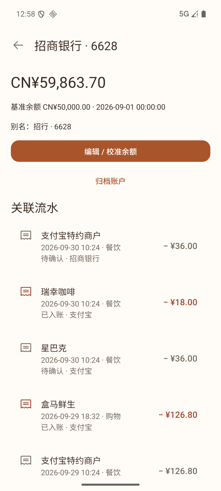
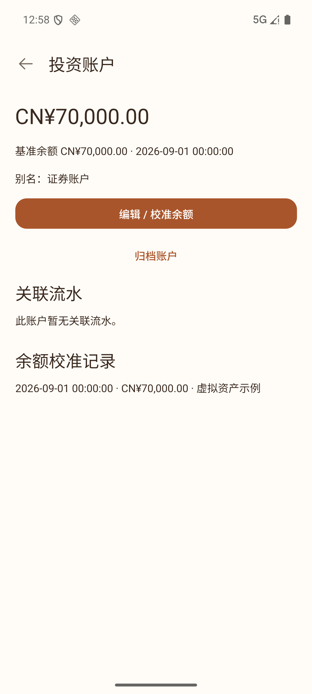
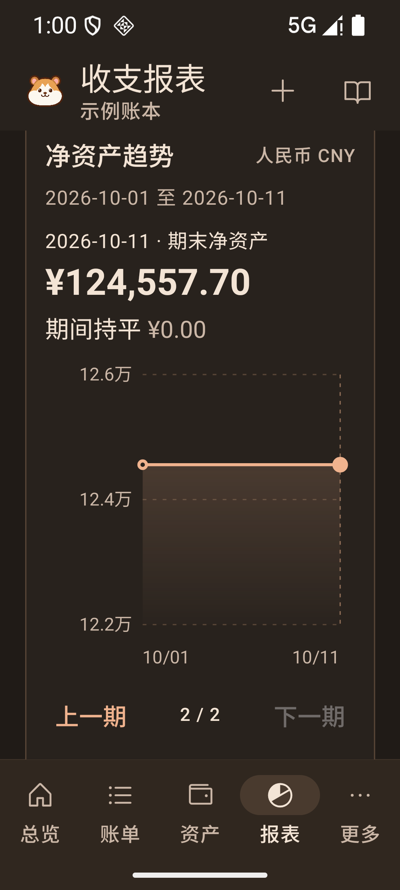
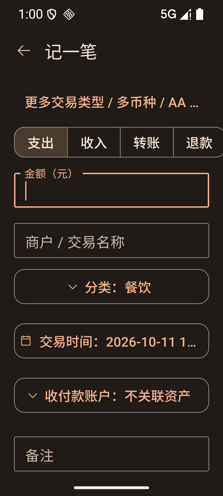
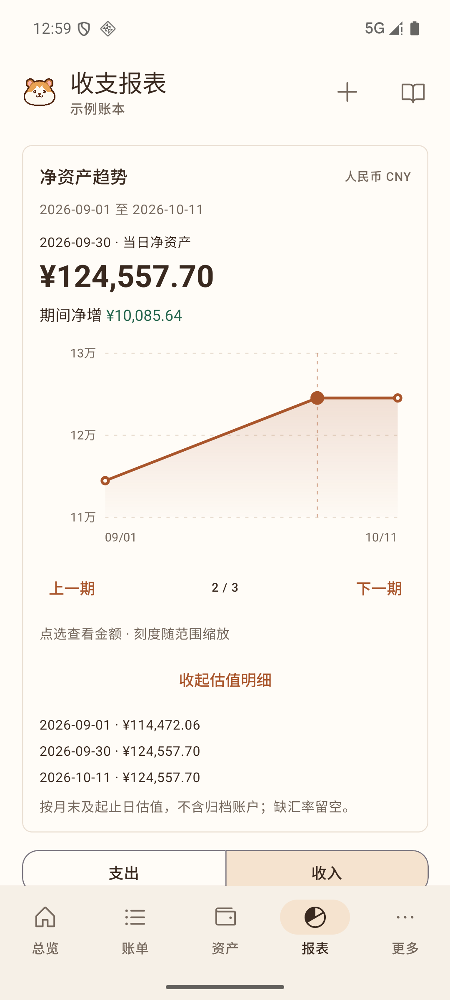
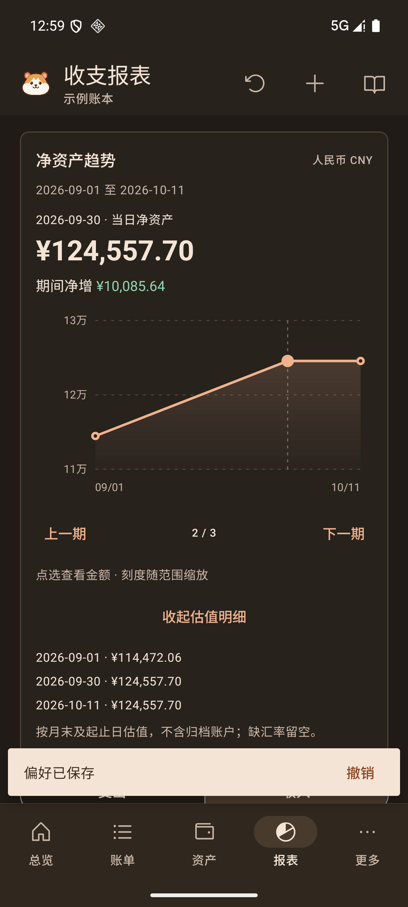
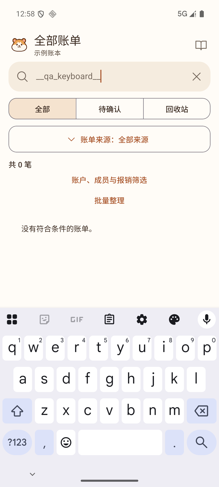
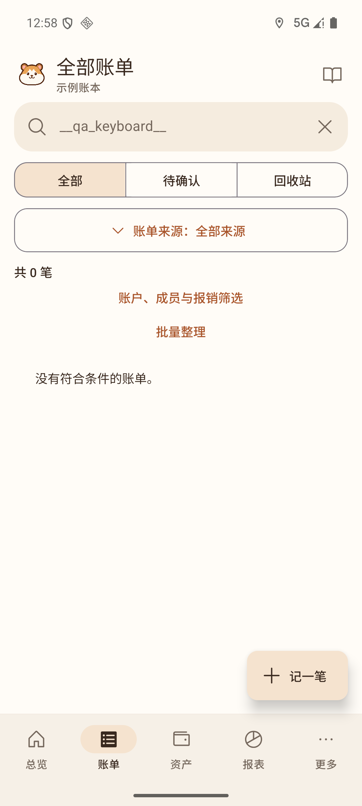

# Android 交互走查修复

[2026-10-11 走查](android-ui-walkthrough-2026-10-11.md)发现的三项问题已修复，并用新的原生 APK 复测。代码提交为 `dd2b1a95cd8dc8959faa824df6fb024511474c2c`。

## 账户详情恢复旧账单关联

`AccountRecordList` 复用核心 `linkedAccountRecords`，按稳定 ID、唯一名称或别名关联流水，保留转入账户和主动解除关联的规则，并过滤已删除记录。账户没有流水时显示明确空态。

回归用例验证示例账本可关联 123 条流水。安卓账户详情能显示旧流水，点击瑞幸咖啡可打开对应的 ¥18.00 账单。招商银行余额仍为 CN¥59,863.70，没有改变余额计算。

| 旧流水恢复显示                                                                          | 无流水账户的空态                                                               |
| --------------------------------------------------------------------------------------- | ------------------------------------------------------------------------------ |
|  |  |

## 报表记账入口移到顶部

报表页使用顶部工具栏的“记一笔”按钮，其他主页面继续使用浮动入口。顶部按钮为 48dp，不覆盖图表。

在 API 36、1080 × 2400、540dpi、1.3 倍字体下，复用修复前的点击坐标 `(835,1917)`：

- 修复前，该位置被浮动按钮覆盖，点击后进入记账表单。
- 修复后，该位置属于已启用的“下一期”，点击后正常从 2026-10-01 切到 2026-10-11。
- 新记账按钮位于 `[682,163][844,325]`，点击可打开记账表单。

| 点击下一期前                                                                      | 点击同一坐标后                                                                       | 顶部记账入口                                                                      |
| --------------------------------------------------------------------------------- | ------------------------------------------------------------------------------------ | --------------------------------------------------------------------------------- |
|  |  |  |

## 工具页往返保留当前分析状态

`NavigationLayer` 保留底部页面实例，工具页覆盖其上。后台页面透明、不可触摸，并从无障碍节点中隐藏。关闭工具页后恢复当前会话，无需把临时筛选写入账本。进入工具页时调用 `Keyboard.dismiss`，收起键盘并解除旧输入框焦点，避免隐藏页面继续接收输入。

原生复测同时验证了两种操作：仅打开偏好页后返回，以及保存深色主题后返回。以下状态均保留：

- 日期：2026-09-01 至 2026-10-11。
- 收支类型：收入。
- 分类维度：按标签。
- 图表选中点：2026-09-30。
- 估值明细：展开。

进入工具页时，原生无障碍树不包含后台报表、导航和记账按钮。实际切换账本后，报表按新账本重新初始化，避免沿用上一账本的筛选状态。 从搜索框打开账本管理后，原生输入法的显示状态为关闭，旧搜索框失焦；返回后搜索词和筛选结果仍保留。

| 进入工具页前                                                                       | 查看偏好后返回                                                                            | 保存主题后返回                                                                      |
| ---------------------------------------------------------------------------------- | ----------------------------------------------------------------------------------------- | ----------------------------------------------------------------------------------- |
|  |  |  |

## 检查与交付

`npm run check` 通过 237 项测试：174 项 Vitest、50 项服务端、4 项 Sites 和 9 项依赖检查。新增 6 项原生组件回归用例，覆盖旧账单、名称和别名、主动解除关联、已删除记录、歧义账户、转入流水，以及工具页往返状态保留。

原生 UI 用例使用 React DOM 平台适配器验证组件行为；点击坐标、屏幕展示和实际路由由原生 APK 验证。`tsconfig.mobile-tests.json` 单独检查原生测试的类型，避免 React Native 与 Web 的全局类型相互影响；根 `typecheck` 同时运行两类检查。

`npm run android:apk` 的 ARM64 Release 构建及升级安装通过，模拟器中安装的 APK 哈希与交付包一致。验证前后示例账本均为 124 笔，支出 ¥8,642.30、收入 ¥18,500.00、结余 ¥9,857.70。未保存测试账单。原选中账本、主题、密度和字体已恢复，测试模拟器已关闭。

APK 为 0.2.0 ARM64，使用开发签名，供安装验证。SHA256：`3c7d3bfbbd2f9fbfa1e6ac31b84eb33a04c15833414476cbc90eec5bdf799f73`。逐项验证数据见 [verification.json](evidence/ui-walkthrough-2026-10-11/fixed/verification.json)。本轮没有进行真实设备或人工 TalkBack 朗读验收。

## 搜索输入与工具页切换

| 搜索时键盘打开                                                               | 从工具页返回，条件保留、键盘关闭                                                      |
| ---------------------------------------------------------------------------- | ------------------------------------------------------------------------------------- |
|  |  |
