# Android UI 交互走查，2026-10-11

后续状态：三项问题已修复并完成原生复测，见[修复记录](android-ui-fixes.md)。以下保留修复前 `84f2907` 的走查与截图。

本轮确认三处待修复问题：账户详情漏显示旧账单的关联流水，小屏浮动按钮遮挡图表翻期按钮，以及打开偏好页后报表日期重置。图表点选、正常翻期、日期校验、明细展开、搜索和草稿退出保护可正常操作。本轮没有修改应用源码。

## 验证范围

- 源码：`84f2907a91a59135897311e8db7ad89e8706aced`。
- 应用：0.2.0 ARM64 Release 测试 APK。已读取模拟器中安装的 `base.apk`，SHA256 与交付包一致：`dfe01d9974c180ea0545c22f9eaecaf6cad85f0e0cd3b95726604e984fd9080f`。
- 环境：Android API 36，1080 × 2400，手势导航。常规密度 420dpi、字体 1.0，小屏密度 540dpi、字体 1.3，对应约 320dp 宽度。实际走查奶油暖棕和深夜账本主题。
- 数据：仅操作示例账本。截图均在本轮通过 ADB 原生截屏，并逐张打开检查；没有沿用上一轮截图。
- 目标：从账本、账单和资产页面进入报表，筛选日期并查看资产趋势，再检查表单退出、页面返回和小屏操作。

## 逐步结果

| 步骤 | 操作                                                                 | 结果                                                                                | 当前截图                                                                                                                                                                                                                  |
| ---- | -------------------------------------------------------------------- | ----------------------------------------------------------------------------------- | ------------------------------------------------------------------------------------------------------------------------------------------------------------------------------------------------------------------------- |
| 1    | 切换示例账本，进入总览并访问五个底部入口                             | 正常，标题与目标页面对应                                                            | [01 总览](evidence/ui-walkthrough-2026-10-11/01-overview.png)                                                                                                                                                             |
| 2    | 全部、待确认筛选，搜索无匹配词，再清空搜索                           | 正常，分别显示 124、12、0 笔，清空后恢复 124 笔                                     | [02 账单](evidence/ui-walkthrough-2026-10-11/02-records.png)                                                                                                                                                              |
| 3    | 打开瑞幸咖啡详情并通过系统返回键退出                                 | 正常，显示支出 ¥18.00 和收付款账户，返回列表                                        | [03 账单详情](evidence/ui-walkthrough-2026-10-11/03-record-detail.png)                                                                                                                                                    |
| 4    | 进入资产、打开招商银行账户详情，取消估值日选择                       | 详情返回和日期取消正常；关联流水漏显示，见问题 A                                    | [04 账户详情](evidence/ui-walkthrough-2026-10-11/04-asset-detail.png)                                                                                                                                                     |
| 5    | 取消报表日期选择，设置开始日晚于结束日，再恢复有效范围               | 正常，取消保留原值，逆序日期显示明确提示                                            | [05 日期校验](evidence/ui-walkthrough-2026-10-11/05-date-validation.png)                                                                                                                                                  |
| 6    | 点选真实数据点、连续翻期、检查首尾禁用、上下滚动、展开及收起明细     | 正常，起点 ¥114,472.06、期末 ¥124,557.70，期间净增始终为 ¥10,085.64；滚动没有误选点 | [06 曲线](evidence/ui-walkthrough-2026-10-11/06-chart.png)、[07 明细](evidence/ui-walkthrough-2026-10-11/07-chart-details.png)                                                                                            |
| 7    | 普通标签切换，打开记一笔，输入 12.34，关闭键盘，继续编辑，再放弃草稿 | 正常，普通标签切换保留报表范围，退出有未保存提示，放弃后仍为 124 笔                 | [08 表单](evidence/ui-walkthrough-2026-10-11/08-entry.png)、[键盘](evidence/ui-walkthrough-2026-10-11/08-entry-keyboard.png)、[退出提示](evidence/ui-walkthrough-2026-10-11/08-entry-unsaved-dialog.png)                  |
| 8    | 在自定义报表范围下打开记账偏好，不修改或保存，返回报表               | 日期重置为本月，见问题 C                                                            | [09 范围重置](evidence/ui-walkthrough-2026-10-11/09-range-reset.png)                                                                                                                                                      |
| 9    | 深色主题、320dp、1.3 倍字体下点选上一期，再点击下一期                | 发生误触，见问题 B；向上滚动后翻期正常                                              | [10 遮挡](evidence/ui-walkthrough-2026-10-11/10-narrow-overlap.png)、[11 错误目标](evidence/ui-walkthrough-2026-10-11/11-wrong-destination.png)、[12 滚动后](evidence/ui-walkthrough-2026-10-11/12-narrow-workaround.png) |
| 10   | 核对示例账本汇总，恢复原账本、奶油暖棕主题和显示设置                 | 完成，仍为 124 笔，支出 ¥8,642.30、收入 ¥18,500.00、结余 ¥9,857.70                  | [13 结束核对](evidence/ui-walkthrough-2026-10-11/13-baseline-after.png)                                                                                                                                                   |

## 问题 A，P2：账户详情漏显示关联流水

招商银行账户详情显示余额 CN¥59,863.70 和基准余额 CN¥50,000.00，但“关联流水”一栏为空。账单详情中的瑞幸咖啡显示账户为“招商银行 · 6628”。

证据：[账户详情缺少关联流水](evidence/ui-walkthrough-2026-10-11/04-asset-detail.png)。

静态核对与原生现象一致：`AssetsScreen.tsx:180` 只判断 `record.accountId` 和 `transferToAccountId`，示例旧账单使用账户名称，未持有 `accountId`。本轮对同一示例 fixture 调用核心 `linkedAccountRecords` 得到 123 条关联记录，严格 ID 匹配为 0 条。`asset-balances.ts` 通过 `resolveAssetAccount` 识别名称及别名，因此余额已经计入这些流水，详情列表却没有显示。

用户无法从账户余额追溯交易。建议详情列表复用与余额计算一致的账户关联规则，并验证旧账单、名称别名和明确不关联账户的情形。

## 问题 B，P2：浮动记账按钮遮挡翻期，点击进入错误页面

在约 320dp 宽、1.3 倍字体、深色主题下，将图表滚动到标题可见的位置，点“上一期”后“下一期”已启用，但被“记一笔”覆盖。

证据：[点击前的遮挡](evidence/ui-walkthrough-2026-10-11/10-narrow-overlap.png)、[点击后进入记账表单](evidence/ui-walkthrough-2026-10-11/11-wrong-destination.png)。

本轮原生节点坐标为：

- “下一期”：`[712,1836][959,1998]`，`enabled=true`。
- “记一笔”：`[590,1806][1026,1995]`。
- “下一期”中心：`(835,1917)`，位于浮动按钮内。点击后实际打开“记一笔”表单，未切换图表期数。

退出表单后向上滚动，“下一期”移到 `[712,1275][959,1437]`，同样的按钮能正常切到 2026-10-11。这说明翻期逻辑可用，问题在于 `AppShell.tsx:224` 的固定浮动按钮覆盖内容。控件达到 48dp 不能解决被覆盖的问题。

建议为报表提供不覆盖内容的记账入口，或在报表取消浮动入口。复测时应点击按钮实际可见位置，不能只检查节点尺寸。

## 问题 C，P3：打开偏好页后报表日期被重置

先将报表设为 2026-09-01 至 2026-10-11，再进入“更多 → 记账偏好”，不修改、不保存，直接返回报表。开始日变为 2026-10-01，当前范围内的收支汇总随之变为零。

证据：[从偏好页返回后自定义范围丢失](evidence/ui-walkthrough-2026-10-11/09-range-reset.png)。

普通底部标签切换会保留日期，打开和取消记账表单也会保留日期。`AppShell.tsx:205` 在工具页与 `AppNavigation` 之间条件渲染，进入工具页会卸载报表；`ReportsScreen.tsx:29` 随后按本月重新初始化日期。

建议保留当前会话中的报表筛选状态，避免仅查看设置就中断分析，不需要将临时筛选永久写入账本。

## 验证边界与恢复

本轮没有保存测试账单。结束时示例账本总数和汇总与开始时一致，原选中账本、主题、420dpi 密度和 1.0 倍字体均已恢复，测试模拟器已关闭。

原生图表标签、48dp 翻期按钮、键盘显示和未保存确认框得到实际检查。小屏覆盖问题说明不能据此声称无障碍整体通过。本轮未执行真实设备、TalkBack 人工朗读、联机同步或缺汇率网络链路验证，也没有重新运行单元测试与构建。

建议先修复两项 P2，再处理报表筛选状态保留，并用同样的十步流程复测。

## 本轮截图，按操作顺序

| 步骤1：总览，正常                                                        | 步骤2：账单筛选，正常                                                       | 步骤3：账单详情，正常                                                             |
| ------------------------------------------------------------------------ | --------------------------------------------------------------------------- | --------------------------------------------------------------------------------- |
| 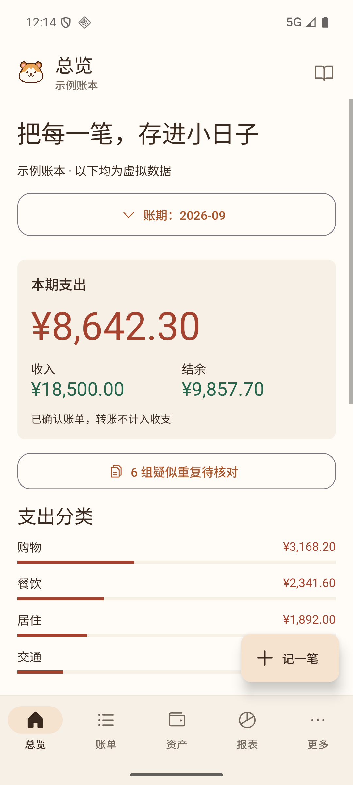 | 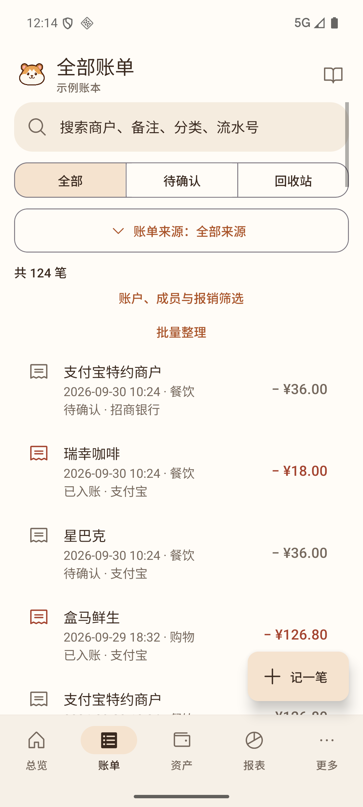 | 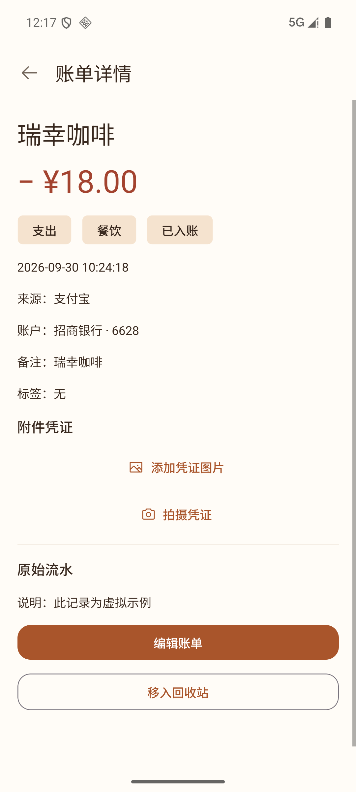 |

| 步骤4：账户详情，漏流水                                                            | 步骤5：日期校验，正常                                                               | 步骤6：曲线点选，正常                                                     |
| ---------------------------------------------------------------------------------- | ----------------------------------------------------------------------------------- | ------------------------------------------------------------------------- |
| 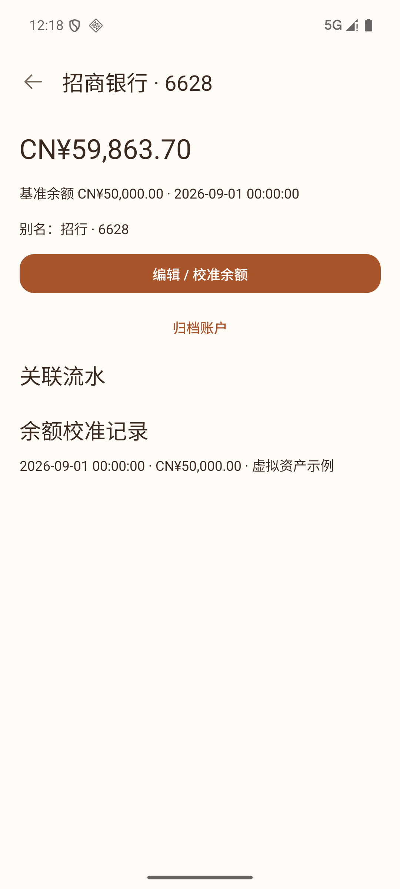 | 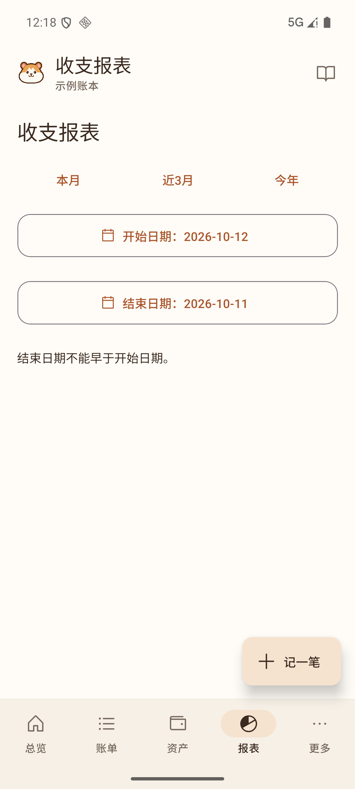 | 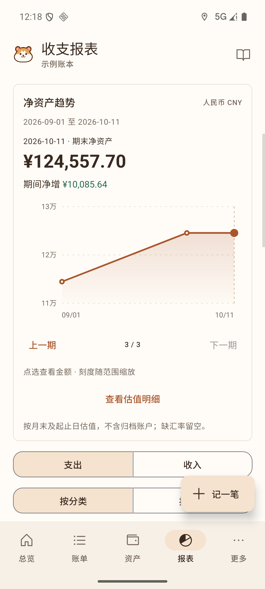 |

| 步骤6：估值明细，正常                                                             | 步骤7：打开表单，正常                                                     | 步骤7：键盘输入，正常                                                              |
| --------------------------------------------------------------------------------- | ------------------------------------------------------------------------- | ---------------------------------------------------------------------------------- |
| 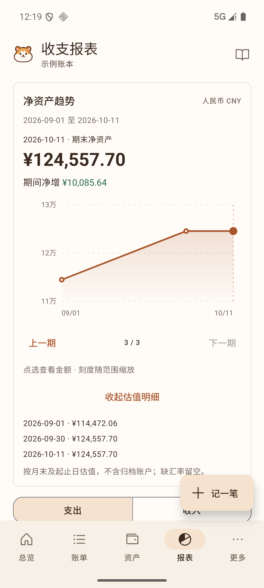 | 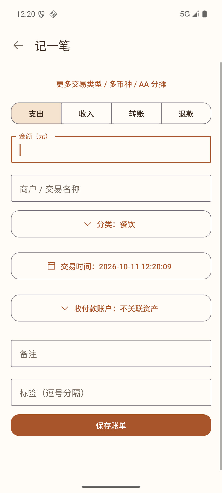 | 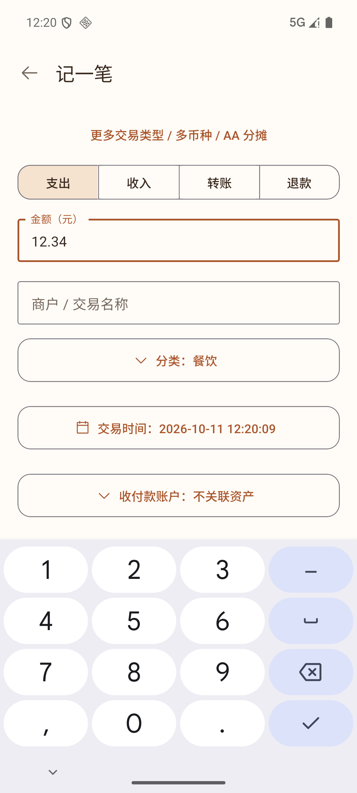 |

| 步骤7：退出确认，正常                                                                    | 步骤8：日期重置，异常                                                           | 步骤9：下一期被遮挡，异常                                                              |
| ---------------------------------------------------------------------------------------- | ------------------------------------------------------------------------------- | -------------------------------------------------------------------------------------- |
| 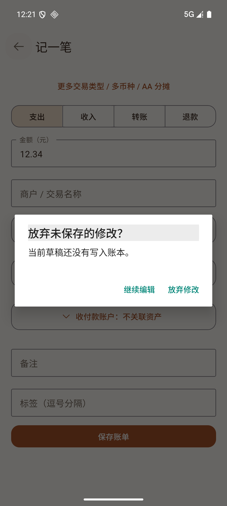 | 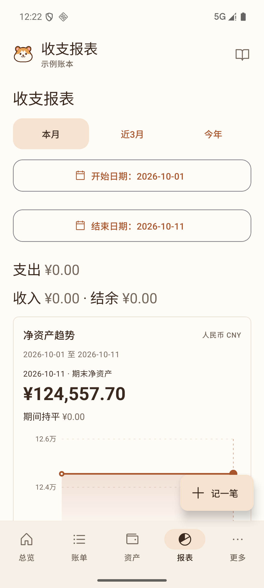 | 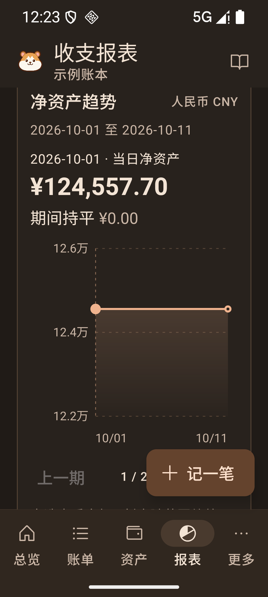 |

| 步骤9：点击后错误页面                                                                 | 步骤9：滚动后翻期正常                                                                 | 步骤10：汇总核对与恢复                                                              |
| ------------------------------------------------------------------------------------- | ------------------------------------------------------------------------------------- | ----------------------------------------------------------------------------------- |
| 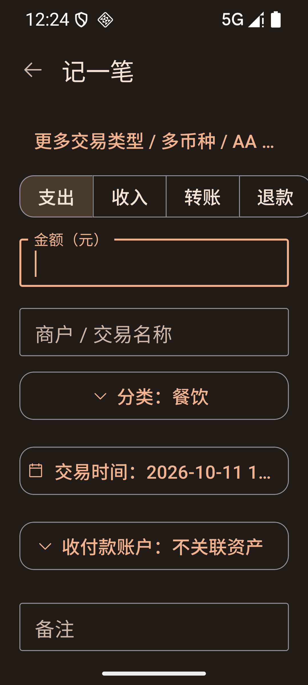 | 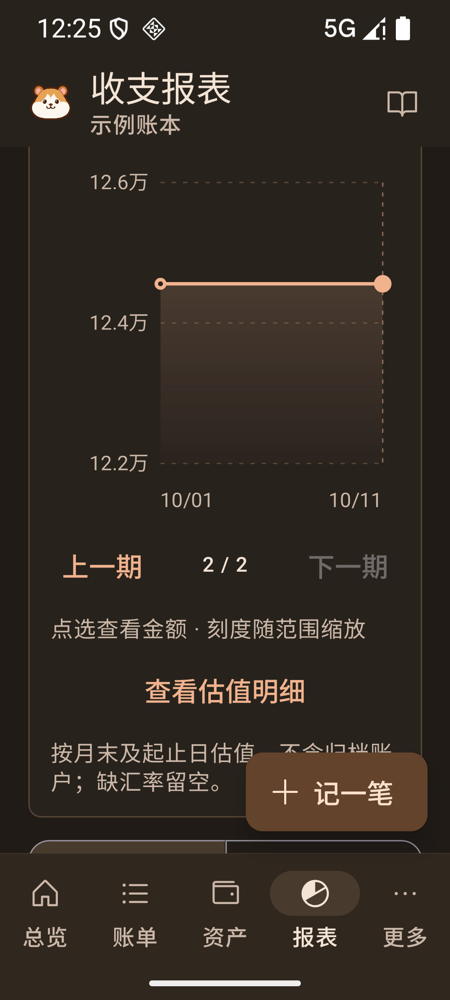 | 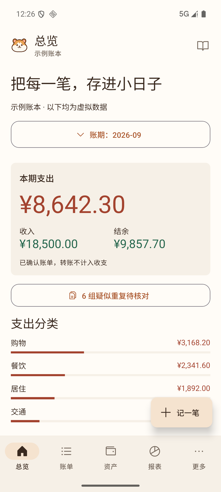 |
